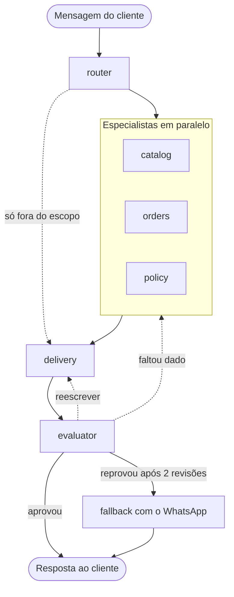
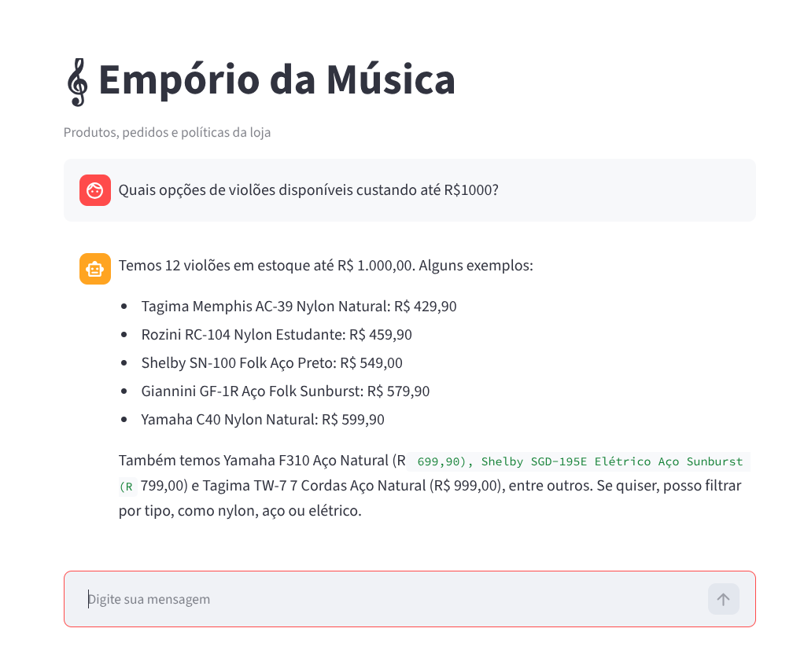
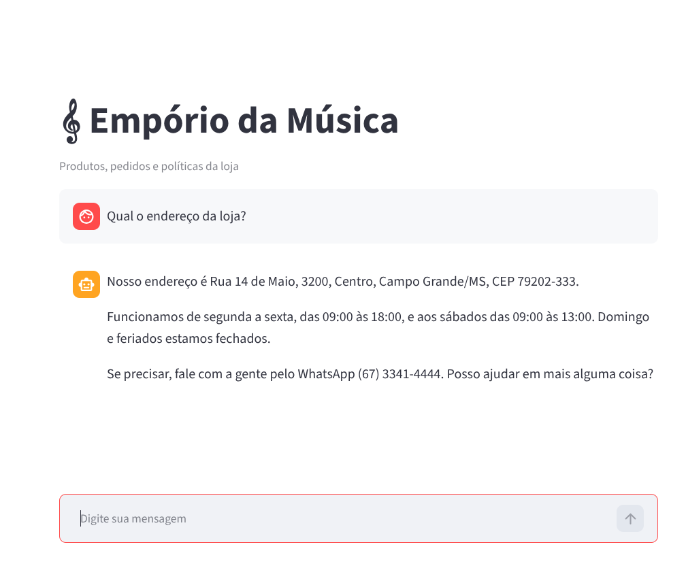
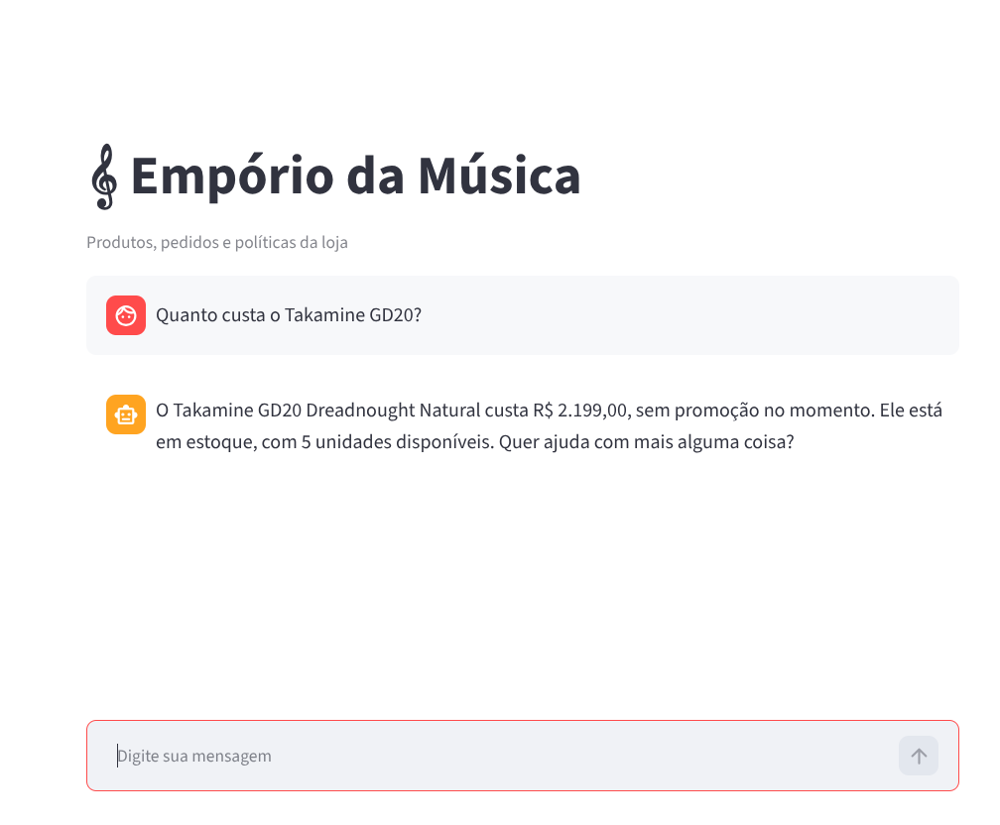
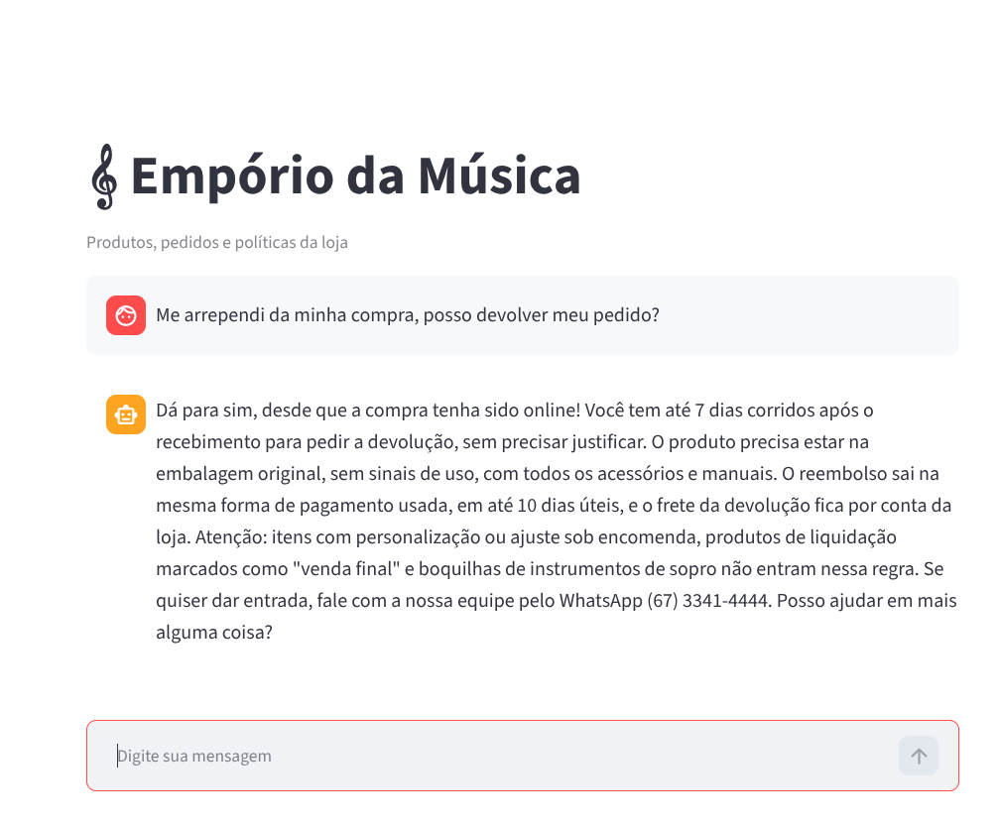

# Empório da Música: agente de atendimento

Este projeto é a minha solução para o desafio técnico da Artefact. É um agente de atendimento para a loja fictícia Empório da Música, que responde perguntas sobre produtos, preços, estoque, promoções, status de pedidos e políticas da loja.

## Como rodar

Você precisa de Python 3.12+ ou do [uv](https://docs.astral.sh/uv/).

```bash
uv sync
cp .env.example .env        # coloque sua ANTHROPIC_API_KEY
```

Depois, em dois terminais:

```bash
uv run artefact                          # API em http://127.0.0.1:8000
uv run streamlit run frontend/app.py     # chat em http://localhost:8501
```

Também dá para chamar a API direto:

```bash
curl -X POST http://127.0.0.1:8000/invoke -H "Content-Type: application/json" \
  -d '{"session_id": "t1", "message": "Quanto custa o Takamine GD20?"}'
```

### Variáveis do `.env`

| Variável | Exemplo | Para que serve |
|---|---|---|
| `ANTHROPIC_API_KEY` | | chave da API |
| `LLM_MODEL` | `anthropic:claude-haiku-5-5` | modelo usado, no formato `provedor:modelo` do LangChain |
| `LLM_EFFORT` | `low` | esforço de raciocínio (opcional) |
| `LLM_MAX_TOKENS` | `16000` | limite de tokens na resposta |

Para usar outro provedor, troque o `LLM_MODEL` (por exemplo `openai:...`) e preencha a chave dele.

## Arquitetura



O agente é um grafo em LangGraph servido por uma API FastAPI. Cada mensagem passa por estas etapas:

1. O **router** lê a mensagem e divide em tarefas, no máximo uma por especialista. Também marca o que está fora do escopo da loja.
2. Os **especialistas** rodam em paralelo:
   * **catalog** busca produtos, preços, estoque e promoções ativas.
   * **orders** consulta status e rastreio de um pedido, mas só com o número do pedido e o e-mail ou telefone do cliente.
   * **policy** responde sobre as regras da loja usando o manual, que já está no prompt.
3. O **delivery** junta os resultados e escreve uma resposta só, em português e no tom da loja.
4. O **evaluator** confere se a resposta cobre tudo o que foi perguntado e se não tem nada inventado. Se reprovar, pede para refazer a busca ou só reescrever, até 2 vezes. Se ainda assim não aprovar, o cliente recebe uma mensagem pedindo para falar com a equipe pelo WhatsApp.

O histórico da conversa fica em memória, separado por `session_id`.

```
src/artefact/
  api.py, orchestrator.py, llm.py   # API, grafo e modelo
  agents/<agente>/                  # node.py, schema.py, tools.py
  prompts/*.md                      # um prompt por agente e a persona da loja
  data/                             # leitura dos CSVs e do PDF, sem LLM
frontend/app.py                     # chat em Streamlit
```

## Decisões técnicas

* **LangGraph**, porque o fluxo tem agentes em paralelo e um ciclo de revisão.
* **Claude Haiku**, porque atendimento precisa de resposta rápida e barata.
* **Sem RAG vetorial.** O manual é pequeno e vai inteiro no prompt.
* **Tools para consultar os dados.** O modelo pede a informação e o código busca nos CSVs, então ele não inventa preço nem vê dados de outros clientes.
* **Um prompt curto por agente**, e só um agente escreve para o cliente.

## Tratamento dos dados e suposições

* Produtos descontinuados ou que ainda vão chegar não são vendidos.
* Só valem as promoções ativas.
* Quando o total do pedido não bate com os itens, informo o total cobrado.

## Exemplos

Conversas feitas no chat em Streamlit. As imagens também estão em [`examples/`](examples/).

**Catálogo com filtro de preço.** O agente consulta os violões em estoque até R$ 1.000.



**Informação da loja.** Endereço e horário vêm do manual.



**Preço de um produto.** Preço e estoque vêm da consulta ao catálogo.



**Política de devolução.** O agente aplica a regra de arrependimento do manual, com as exceções.



## Limitações e o que eu faria com mais tempo

* **Latência e custo.** Cada mensagem faz de 4 a 6 chamadas ao modelo e leva uns 10 segundos ou mais, pularia o evaluator em respostas simples como comprimentos e mostraria a resposta.
* **Histórico em memória.** Ele se perde quando a API reinicia. Eu trocaria por um checkpointer em sqlite ou postgres.
* **Sem testes automatizados.** Testei os fluxos na mão. Eu adicionaria testes das consultas e das decisões do grafo.

## Uso de assistentes de código

Usei o Claude Code dentro do VS Code durante todo o projeto.

* **Análise dos dados.** Pedi scripts para encontrar problemas nos CSVs.
* **Implementação.** Fui construindo um agente por vez e revisando cada mudança. As decisões de arquitetura e de produto foram minhas.
* **Depuração.** Usei para investigar, pelos logs, os loops de chamadas de tool e os erros da API.
