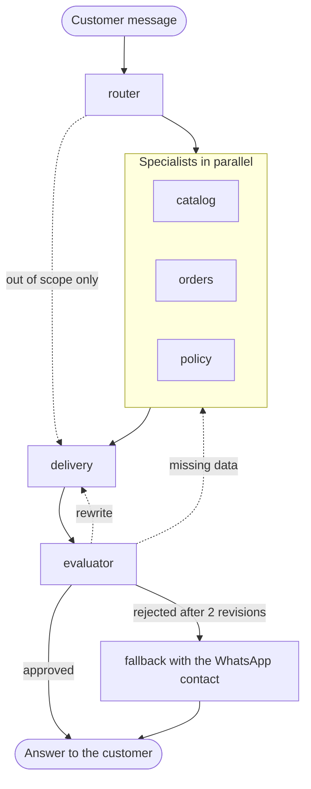
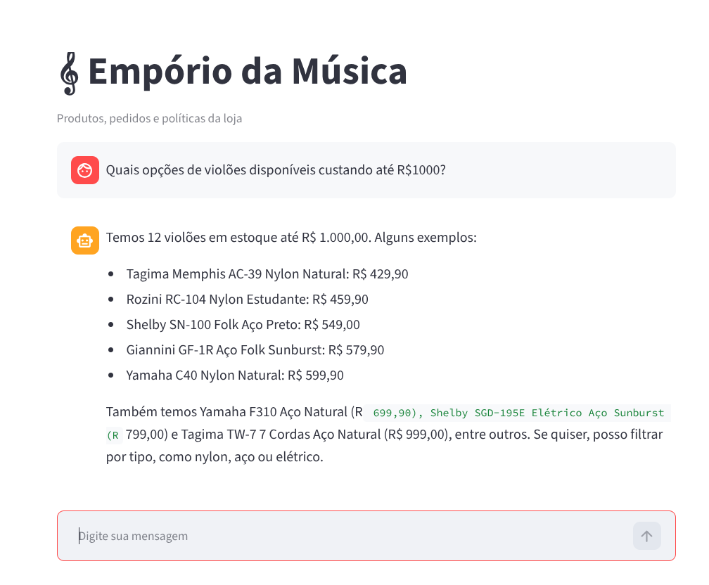
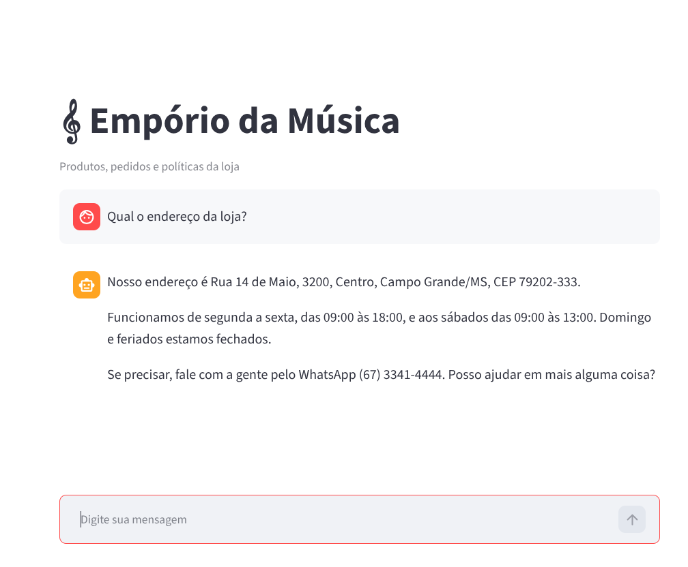
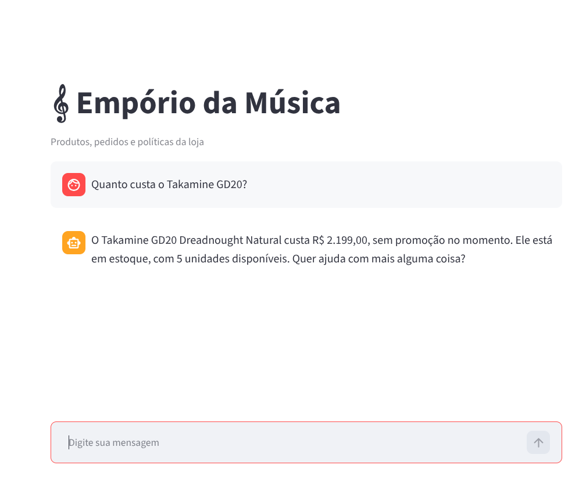
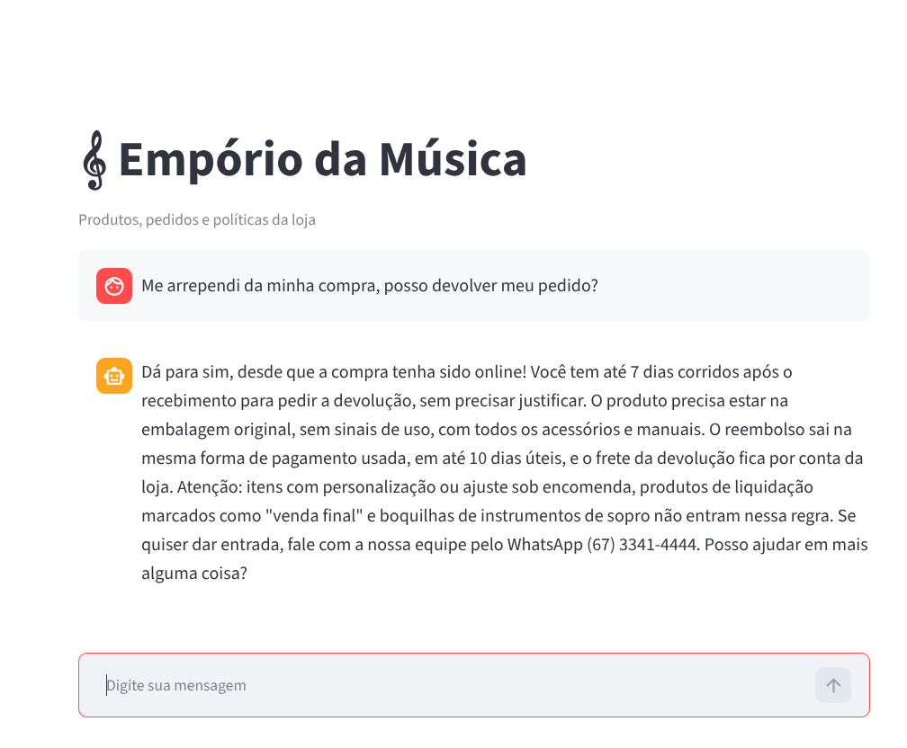

# Empório da Música: customer service agent

This project is my solution to the Artefact technical challenge. It is a customer service agent for the fictional store Empório da Música. It answers questions about products, prices, stock, promotions, order status and store policies.

## How to run

You need Python 3.12+ or [uv](https://docs.astral.sh/uv/).

```bash
uv sync
cp .env.example .env        # add your ANTHROPIC_API_KEY
```

Then, in two terminals:

```bash
uv run artefact                          # API at http://127.0.0.1:8000
uv run streamlit run frontend/app.py     # chat at http://localhost:8501
```

You can also call the API directly:

```bash
curl -X POST http://127.0.0.1:8000/invoke -H "Content-Type: application/json" \
  -d '{"session_id": "t1", "message": "Quanto custa o Takamine GD20?"}'
```

### `.env` variables

| Variable | Example | What it is for |
|---|---|---|
| `ANTHROPIC_API_KEY` | | API key |
| `LLM_MODEL` | `anthropic:claude-haiku-5-5` | model to use, in LangChain's `provider:model` format |
| `LLM_EFFORT` | `low` | reasoning effort (optional) |
| `LLM_MAX_TOKENS` | `16000` | token limit for the response |

To use another provider, change `LLM_MODEL` (for example `openai:...`) and fill in its key.

## Architecture



The agent is a LangGraph graph served by a FastAPI API. Each message goes through these steps:

1. The **router** reads the message and splits it into tasks, at most one per specialist. It also flags anything outside the store's scope.
2. The **specialists** run in parallel:
   * **catalog** looks up products, prices, stock and active promotions.
   * **orders** checks the status and tracking of an order, but only with the order number and the customer's email or phone.
   * **policy** answers questions about the store rules using the manual, which is already in the prompt.
3. The **delivery** agent combines the results and writes a single answer, in Portuguese and in the store's tone.
4. The **evaluator** checks that the answer covers everything that was asked and that nothing is made up. If it rejects the answer, it asks for a new lookup or just a rewrite, up to 2 times. If the answer still is not approved, the customer gets a message asking them to contact the team on WhatsApp.

The conversation history is kept in memory, separated by `session_id`.

```
src/artefact/
  api.py, orchestrator.py, llm.py   # API, graph and model
  agents/<agent>/                   # node.py, schema.py, tools.py
  prompts/*.md                      # one prompt per agent and the store persona
  data/                             # reads the CSVs and the PDF, no LLM
frontend/app.py                     # Streamlit chat
```

## Technical decisions

* **LangGraph**, because the flow has agents running in parallel and a review loop.
* **Claude Haiku**, because customer service needs fast and cheap answers.
* **No vector RAG.** The manual is small and goes into the prompt in full.
* **Tools to query the data.** The model asks for the information and the code looks it up in the CSVs, so it does not make up prices or see other customers' data.
* **One short prompt per agent**, and only one agent writes to the customer.

## Data handling and assumptions

* Discontinued products and products that have not arrived yet are not sold.
* Only active promotions count.
* When the order total does not match the items, I report the total that was charged.

## Examples

Conversations from the Streamlit chat. The images are also in [`examples/`](examples/).

**Catalog with a price filter.** The agent looks up the acoustic guitars in stock up to R$ 1,000.



**Store information.** Address and opening hours come from the manual.



**Price of a product.** Price and stock come from the catalog lookup.



**Return policy.** The agent applies the right of withdrawal rule from the manual, with its exceptions.



## Limitations and what I would do with more time

* **Latency and cost.** Each message makes 4 to 6 model calls and takes around 10 seconds or more. I would skip the evaluator on simple replies such as greetings and show the answer right away.
* **In-memory history.** It is lost when the API restarts. I would replace it with a sqlite or postgres checkpointer.
* **No automated tests.** I tested the flows by hand. I would add tests for the data lookups and the graph decisions.

## Use of coding assistants

I used Claude Code inside VS Code throughout the project.

* **Data analysis.** I asked for scripts to find problems in the CSVs.
* **Implementation.** I built one agent at a time and reviewed each change. The architecture and product decisions were mine.
* **Debugging.** I used it to investigate tool call loops and API errors through the logs.
